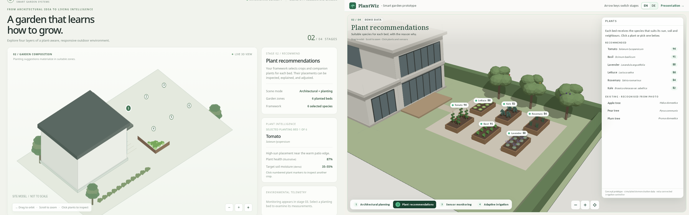
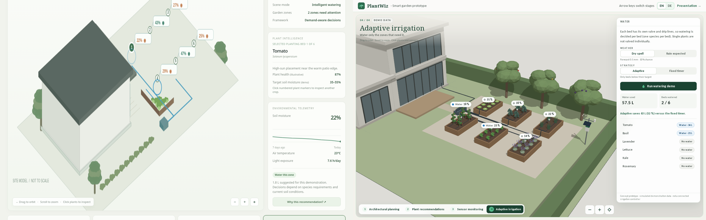

# Migration report

## Inputs received

| Input | File(s) | Status |
|---|---|---|
| A · Prototype | `original_prototype/index.html` | Inspected, audited in a browser, preserved (also served at `/original/index.html`) |
| B · References | `reference_images/` (6 images, 1 video, preview AVIF, `Archive.zip`) | All analysed (`design-system.md`). `Archive.zip` contains the same 8 files as the folder. `video_preview_0000.jpg` is actually AVIF. `1-planning.jpg` (alamy) and the video (envato) carry stock watermarks and are used as references only |
| C · PowerPoint | `original_presentation.pptx` (9 slides + notes) | Migrated slide by slide (`presentation.md`) |
| D · Architecture visualisation | `original_prototype/gardentwin/GardenTwinArchitecture.jsx` + `README.md` (same files in `GardenTwin_React_Architektur.zip`) | Migrated to `src/architecture/` in the deck's style, shown as slide 11 and at `/architecture` (`architecture-diagram.md`) |
| E · Business documents | `GardenTwin_Prototyp_Level_Kostenvergleich.md`, `GardenTwin_Geschaeftsmodell_Finanzkalkulation.md` (pasted in the session, saved to `source_documents/`) | Slides 12–14. Arithmetic errors found and corrected (`business.md`) |

**Not supplied, documented instead of invented:**
- No 3D model files (GLB/OBJ). The house is a parametric model built from reference 1, and replacing it is documented.
- No real recommendation-framework output. Fixture data is labelled as example data, behind a validated provider interface.
- No real sensor data. Simulated data is deterministic and labelled.
- No PlantWiz brand guide beyond the PPTX theme, which was used as the brand source.

## Before → after

| Aspect | Original | Now |
|---|---|---|
| Rendering | 2D canvas with hand projection and back-to-front polygon sorting | WebGL (three.js r182 via React Three Fiber 9) with depth buffer and shadows |
| Visual style | Generic flat illustration | Architectural line drawing (plan → dimensions → extruded walls) that evolves into a rendered garden, after the references |
| Scene per stage | One model, but beds hidden behind the house | One model and five cascading layers; nothing overlaps (unit-tested) |
| Camera | Custom yaw/pitch, distorts and clips | Perspective 32°, orbit with limits, smooth stage glides, reset, zoom buttons |
| Interaction | Hit-test on six screen points | Raycasting on plants, beds, trees, probes, the weather station and zones; chips; panel lists |
| Stage 1 | Wireframe house and grid | Plan with dimensions, construction lines, selectable planting zones with area, sun and soil |
| Stage 2 | Six species, "health" shown before any sensor | Six species (scores and reasons) plus three recognised existing trees; health removed from this stage |
| Stage 3 | Three posts, six readings, health as measured | Six probes plus a weather station, 7-day charts with target band, health clearly *estimated* |
| Stage 4 | Hard-coded actions, `alert()` | Computed decisions, weather scenario, adaptive vs fixed timer (57.5 L vs 120 L), animated flow, per-bed valves |
| Data | Inline literals | Typed fixtures, pure logic, seeded histories, API contract |
| Embedding | Global keys and wheel, no container resize | Controlled/uncontrolled component; one persistent instance per deck; key and pointer isolation |
| Language | English, brand "VERDANT" | German in the deck, EN/DE standalone, brand PlantWiz |
| Tests | none | 148 unit/component/integration, 14 E2E, 18 visual |
| Performance | rAF loop always running | On-demand rendering, paused when hidden, instancing, shared materials, lazy three.js chunk |

## Presentation

The 9 PPTX slides became 9 TSX slides with unchanged text, figures, sources and notes, plus 4 new live-demo slides inserted after the "three layers" slide, the system-architecture slide after the demo, the prototype-cost slide and the interactive financial model (16 slides). PPTX slide 7 (business model) was updated for consistency with the November 2026 business-model document. The details and known differences are in `presentation.md`.

## Open points / limitations

- Performance was measured only in headless Chromium with software WebGL (SwiftShader), where the scene renders correctly. Frame rates on real presenter hardware were not benchmarked. Measured scene cost per frame (`window.__plantwizGarden.stats()`): planning 72 draw calls / 2.4k triangles, planting 101 / 30k, monitoring 135 / 32k, irrigation 168 / 49k, with 11–12 shader programs. That is modest for any modern laptop, and frames are only rendered while something moves. Please still check on the actual presentation machine.
- Only Chromium is covered by the automated tests; Firefox and Safari were not run.
- Tablet layout: the garden switches to a bottom-sheet panel and compact stage labels below about 768 px of container width. Touch orbiting comes from OrbitControls. It was not tested on a physical tablet.
- Speaker notes are shown below the slide in windowed mode. There is no separate presenter-view window.
- The recommendation API wiring stops at the provider interface (see `prototype.md`): no live endpoint exists yet.
